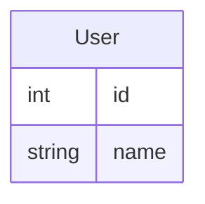

# difftool walkthrough

A walkthrough is a narrative review path: chapters contain stops, and each stop explains one part
of a change beside its live diff hunks. Its JSON stores hunk references, not copies of the diff.

Write for a colleague who knows the codebase but not this change. The reviewer should finish the
tour understanding the goal, the important behavior, and the decisions or risks worth examining.

## Scope the deliverable first

Classify the requested output before any review or authoring tool call.

- For an authoring file, read-only inspection or validation, new attachment, or update, load the
  authoring and attachment skill reference by running `difftool walkthrough skill authoring`, then
  select the exact operation it defines before acting. Only an explicit request to attach, replace,
  or update authorizes a mutating `set`; validation alone permits `set --dry-run`, never attachment.
- For a proposed walkthrough, audit, evaluation, or other explicitly read-only draft, return the
  requested stops and finished representations directly. Do not run `walkthrough init`, `set`,
  `clear`, comment commands, or inspect authoring schemas merely to simulate attachment. Do not open
  the viewer unless visual verification was requested or is justified by the final verification
  rule below.

Explicit scope limits override the attachment workflow. If the user supplies a review reference,
use it directly; do not list reviews merely to rediscover it. Inspect generic CLI help, repository
schema documentation, or daemon state only when a concrete failure or requested output makes that
inspection necessary.

## What is fixed and what is judgment

Factual accuracy and fidelity to the requested scope are always hard constraints. For an authored
walkthrough, the schema, selected component contracts, and anchor validity are hard constraints too;
attachment and update also require the accepted Snapshot boundary. Length, order, stop density,
discovery depth, and medium are judgment calls.

Each stop should answer a useful review question. Reference live hunks instead of reproducing them.
Use the smallest faithful representation, but spend on a richer form when it materially reduces the
reviewer's work. When two forms are equally clear and faithful, prefer the smaller one. No medium is
required for its own sake, and variety is not a goal.

Optimize the walkthrough as one story, not as a showcase of individual renderers. A locally
impressive artifact is wrong when it interrupts the narrative, repeats a model already established,
or answers no material review question. An uncommon renderer is equally valid when it is the clearest
way to expose the evidence. There is no preference order among prose, Markdown, Mermaid, Vega-Lite,
or registered components.

The representation guidance below provides examples and tie-breakers, not an allowed list, quota,
or fixed decision algorithm. Use any renderer-supported form or combination that best fits the
evidence, the review question, and the surrounding stops. The examples should sharpen judgment,
not replace it.

## Build the review story

### Establish intent

Find the problem, the author's approach, and the decisions or risks the reviewer should examine.
Read the PR or MR description, relevant issue or design document, and enough code to verify the
intent. Read an attached design document with:

```sh
difftool review design get --review <ref> --name <name>
```

Reduce the context to a one-sentence goal and the review questions that make the change
understandable. If those are still unclear, keep reading.

### Lay out the stops

Order stops to minimize context switching. Cause and effect and review leverage are good defaults;
file order, chronology, or the user's requested path may be clearer for a particular change. Make
the goal clear before later stops depend on it, and end where the payoff, main risk, or key review
decision becomes visible.

A stop usually answers one question, though tightly coupled questions can share one. Give every
stop a short, descriptive display title. Group hunks across files when they implement the same idea.
Avoid mechanical stop-per-hunk tours and whole-file stops
for one local idea. Slice a large hunk when only part advances the story. If the tour sprawls,
tighten the narrative or split genuinely separate stories. Keep chapter titles to 24 characters or
fewer so they remain scannable in the sidebar.

### Gather enough evidence efficiently

Start with compact context for the accepted Snapshot:

```sh
difftool review get --review <ref> --walkthrough-context --compact
```

Compact context is an index for discovery, not evidence that omitted lines are mechanical.
Fetch the narrowest additional evidence needed to answer a review question or classify a hunk:

```sh
difftool review get --review <ref> --file 'src/**' --include-lines
difftool review get --review <ref> --hunk src/app.ts:h2 --include-lines
```

Increase `--representative-lines` when a little more context is enough. Fetch broader lines, raw
patches, history, tests, or design material only when the unresolved question requires them. On a
PR, inspect the PR head rather than an unrelated working tree.

Use a narrow-to-deep funnel:

1. Identify the unresolved review questions from compact context.
2. Batch only already-justified independent reads when the tool supports it, or issue those tool
   calls together. Concurrency is not a reason to widen the search.
3. Keep dependent reads sequential when one result determines what to inspect next.
4. Widen only the questions that remain unresolved, and reuse evidence already gathered.

Optimize both round trips and returned context. One batch of targeted reads is efficient; one broad
read that returns mostly irrelevant material is not. Do not minimize tool-call count at the cost of
unsupported claims, and do not keep reading merely to demonstrate thoroughness. Reuse compact
context unless its parameters or accepted Snapshot change.

Here and below, a batch means one tool invocation containing the independent calls, run in parallel
when supported—not several successive calls described as one logical phase. After the review and
scope are known, do not preflight with review inventory, generic help, schema/scaffold inspection, or
daemon diagnostics. Use the narrowest such check only after a necessary command actually fails or
its syntax is genuinely unknown. If a broad response is truncated, switch to targeted file or hunk
reads; truncation alone is not a reason for unrelated diagnostics.

Compact context moves generated and support-like files into `supportCandidateGroups`. Inspect them
when they affect the story. `init` prepopulates `support`; retain only groups that genuinely belong
there. Sampled renames do not establish that an entire file is mechanical, especially in tests:
new cases or changed assertions may be important evidence for the story.

Stop discovery when every material claim has enough evidence and no known unresolved question is
likely to materially change the anchors, explanation, order, or representation.

## Choose the representation

### Representation gate

Before drafting any stop prose, check every material review question against these triggers. A
trigger matches only when that mental task is material to the current review question; incidental
numbers, branches, files, or domain terms do not match by themselves. Do not choose a representation
until this check is complete.

- If the reviewer must compare cases, values, or contracts, or inspect a small algorithm, call
  path, ownership/component tree, or code shape, load the Markdown and code-shape skill reference
  by running `difftool walkthrough skill markdown`.
- If a Mermaid family is a plausible finalist because the reviewer must inspect structured
  relationships, mappings, topology, or progression, load the Mermaid skill reference by running
  `difftool walkthrough skill mermaid`. Examples include entity cardinality, actor messages,
  lifecycle transitions, chronology, hierarchy, branch/join topology, requirements, wire layouts,
  causal groupings, overlap, and tradeoff or domain maps. One local guard, flat result switch, or
  shallow local tree does not trigger Mermaid by itself.
- If the conclusion depends on measured magnitude, change, distribution, correlation, or uncertainty:
  Load skill for Vega-lite selection and validation by running `difftool walkthrough skill charts`.
- If a purpose-built registered component is a concrete candidate because you can name the material
  structure it would encode, inspect the compact catalog with `difftool walkthrough components`;
  knowing the component's name is not required. Examples include an HTTP contract, nested JSON value,
  actual path hierarchy, measured view, fixed motion, interaction, or another specialized semantic
  shape; these examples are not the catalog's boundary. Database or other domain-specific code alone
  is not a catalog trigger.

When a trigger matches, loading its guide or catalog is required; using that representation is not,
and the required read gives that medium no preference. Finish classifying every material review
question before reading any representation reference. In the next single tool invocation, load
every independently matched guide and the compact catalog together, in parallel when supported. Do
not split already-known independent reads across invocations. Read sequentially only when one result
genuinely determines whether another read is needed. Do not load references whose trigger is absent.
Before defaulting to prose, check for a specialized renderer-supported shape not named above. If you
can name either a plausible family or the concrete material structure a specialized component would
encode, treat its guide or compact catalog as triggered; otherwise continue with prose. Keep this
classification in working notes rather than adding a media inventory to the walkthrough.

Passing this gate means choosing the right specific form, not merely adding something visual.
Compare the strongest plausible nearby forms at the level that changes understanding: prose versus
a small Markdown shape, table versus chart, sequence versus state versus flowchart, a domain
component versus a generic diagram, or Mermaid versus `Svg` versus `Html`. The chosen form should
faithfully expose the structure or evidence the reviewer must inspect, make the actual review task
easier, and earn its space against a smaller alternative. Remove or replace a visual that decorates,
repeats adjacent prose, uses semantics that do not match the question, or still leaves the reviewer
to reconstruct the important comparison or path. These are judgment criteria, not a scoring formula;
prose is the correct result whenever it wins that comparison.

Start from the reviewer's question and the mental work it asks them to do. These examples help apply
the gate and suggest strong starting points; they do not mandate an output:

| Example review question | Strong starting point |
|---|---|
| Why can `authorizeRequest` no longer accept an expired entry? | concise prose for cause, effect, and preserved behavior |
| Which modes are supported before and after this change? | a Markdown table for exact comparison |
| What is this local decision, call path, component shape, or small shape change? | pseudocode, a shallow tree, or a schematic `diff` block |
| Which actors exchange messages, how does an entity transition, or where do non-local paths split and rejoin? | the matching Mermaid diagram |
| What changed in `POST /api/reviews`—method, path, auth, request, or responses? | `Endpoint` |
| What does this nested retry policy, event, or stored record look like? | `Json` |
| Where do package files, cache entries, or object-store keys live? | `FileTree` |
| Do measured values form a decision-relevant pattern, or are exact cells the evidence? | `Chart`, a Markdown table, or both after comparing pattern with lookup |
| How does ownership or propagation move through one fixed transition? | `Svg` |
| What happens when the reviewer changes an input, failure time, ordering, or branch? | `Html` |

These rows are alternative starting points for different questions, not a checklist for one tour.
Use several only when the story genuinely contains several distinct mental tasks.

Usually pair a visual with a short claim, unless the surrounding prose or component labeling already
makes that claim explicit. Let the visual carry the structure, evidence, motion, or exploration. Do
not add a visual when language is clearer.

When one question contains distinct mental tasks, combine forms deliberately: prose plus Mermaid
for claim and structure, a chart plus a table for pattern and exact values, or `Endpoint` plus
`Json` when the nested value is a separate inspection question. Each form should contribute
something the others do not; avoid duplicating the same fact merely to add variety.

Raw HTML such as `<details>` is allowed only in a component-free stop. Registered components and
raw HTML cannot appear in the same stop. When a stop contains a component, use ordinary Markdown
for secondary evidence or split the raw HTML into another stop. This restriction does not apply to
ordinary Markdown or Mermaid code fences.

A field-only database entity is small enough to show directly:



Add keys or relationships only when they help answer the review question. Read the Mermaid guide
for larger diagrams or when more than one family plausibly fits.

### Domain components when the data already has a shape

For example, one coherent HTTP transport contract often fits `Endpoint`; one concrete nested value
often fits `Json`; actual paths and path responsibilities often fit `FileTree`. These are not default
wrappers for HTTP-related code, any object, or any file change. A flat value may be smaller as a table
or code fence; a conceptual component hierarchy may be clearer as a shallow tree or Mermaid. Do not
repeat one payload across components unless each representation answers a different review question.

### Chart when measured evidence carries the claim

Loading the Vega-Lite guide does not make `Chart` preferred. Use a Markdown table when the reviewer
needs exact old/new values, a small finite cross-product, or one precisely identified exception.
Use `Chart` when pattern, magnitude, variance, tails, correlation, or uncertainty materially reduces
the reviewer's work, and combine them only when both pattern and exact values are decision evidence.

Choose the derived metric that matches the claim: old/new values for exact comparison, signed delta
for absolute gain or regression, and ratio or percentage for relative change across different
baselines. Label it explicitly and name the denominator. Use percentage or ratio only when the
baseline is nonzero and its sign and magnitude make that comparison meaningful; otherwise show raw
values and signed delta unless the domain supplies a clearer convention. Reject a chart whose scale
compresses a material difference, hides a regression, or lets one extreme dominate the comparison;
use a better encoding, a table, or both.
Primary evidence must be visible without hover even when tooltips add detail. Read the Vega-Lite
guide to choose a view, then use the selected `Chart` contract as the authority for syntax and
limits. Never invent measurements or imply unsupported precision.

### Static structure, motion, and interaction

Use the same lease-handoff question to distinguish static structure, passive motion, and
interaction:

- To inspect which participant acts first, use a Mermaid sequence diagram.
- To inspect the lifecycle of the lease itself, use a Mermaid state diagram.
- To watch the ownership token move through one predetermined handoff, use `Svg`.
- To choose the failure time or retry count and observe different outcomes, use `Html`.

These are alternative answers to different questions about the same change, not four artifacts to
include together.

`Svg` earns its place when motion itself explains state, ownership, propagation, or timing. Make the
first frame useful. Use `Html` when the reviewer should vary an input, step an event, trigger a
branch, manipulate a UI, or inspect coordinated state. It may also carry a specialized spatial or
coordinated view that native forms cannot express clearly. Derive either artifact from verified
code, state material simplifications, and follow the component-contract workflow below. Interaction
multiplies unsupported assumptions: every displayed transition and outcome must follow from verified
behavior. If the evidence names inputs but not the rules that map them to outcomes, do not invent a
simulator; explain the missing rule or use a complete static form limited to the verified facts.

### Stop prose vs hunk note vs support vs review comment

Choose the location from what the information does:

| Example need | Put it in |
|---|---|
| Explain the behavior, rationale, causal chain, or review question | stop `prose` |
| Show a table, diagram, chart, or component | stop `prose` beside its short claim |
| Pin one short fact, question, caution, or orientation cue to an exact changed line | a walkthrough hunk `note` |
| Call out something important that is not tied to one exact line | a short paragraph or blockquote in stop `prose` |
| Keep generated, lockfile, fixture, or other off-path churn available without touring it | `support` |
| Create a durable discussion or action thread for a suspected defect, risk, question, or request | a review comment |

A note is an annotation, not a miniature stop. Keep it short, line-specific, and inside the rendered
slice. It may state a fact, question, or caution that helps interpret the line. Put longer reasoning,
cross-line context, and visuals in stop prose. Prefer a review comment when the information should
be tracked as a separate discussion or action. Notes use the same ID or content-match forms as hunk
references. Structured Markdown and components flatten in notes.

The table identifies the proper destination for information; it does not expand the task's scope.
Create a review comment only when the user's request authorizes comments. Otherwise keep relevant
context in stop prose or a short line-pinned note, and report the finding in the response when
appropriate.

Use `support` when the reviewer may need off-path churn but no stop should dwell on it. If a
generated file, fixture, or lockfile is material evidence for behavior or risk, include its relevant
hunk in the stop instead of hiding it in support.

## Use component contracts progressively

Use the compact catalog loaded by the representation gate to choose the strongest candidate from
its `useWhen` and signature. Then fetch only that component's authoritative contract:

```sh
difftool walkthrough components <Name> --json
```

The compact catalog comes from `difftool walkthrough components`; it is not a local
`components.md` reference. When its trigger is already known, run that command in the same batched
tool invocation as the matched Markdown, Mermaid, or Vega-Lite reference reads.

The contract defines syntax, limits, file rules, examples, and detailed authoring guidance. If it
rules the candidate out, choose the next candidate and fetch that contract. Do not preload contracts
for unselected components.

Components live as top-level blocks between Markdown blocks in a stop's `prose`; they add no JSON
fields. Follow the returned grammar instead of guessing attributes or nesting. Author renderable
walkthrough prose, not a source-code presentation: never wrap an entire component or ordinary
Markdown table in a `md` code fence. Write the component tags and table directly in the prose. Fence
only content whose own syntax requires it, such as Mermaid or a component's contract-defined inner
JSON block. Markdown images require browser-resolvable URLs; local `.svg` and `.html` assets are
bundled only through their registered components.

Once a form is selected, author the actual Markdown, Mermaid, Vega-Lite specification, SVG, or HTML.
Do not leave placeholders or describe a visual that was never created. Choose the clearest complete
form whose claims are supported; if the ideal form cannot be delivered, use the best complete
alternative and disclose any material limitation.

An inline code fence containing proposed HTML or SVG source does not satisfy an `Html` or `Svg`
component whose `src` points to a file: the referenced asset must actually exist and be bundleable.
If the requested scope forbids creating that asset, do not emit a dangling component. Use a complete
inline alternative, or state which evidence or authorization is needed to deliver the richer form.

## Write each stop

Lead with the point, then the evidence. Explain behavior rather than syntax line by line.

Keep each stop focused on one review question. Read the prose beside its rendered hunks and remove
anything that merely restates visible code. The main point should appear without scrolling; split or
tighten the stop when it does not.

- **Intent:** Put the goal and review lens in `focus`. Add an opener or closer only when code stops
  cannot carry essential context, payoff, or risk.
- **Behavior:** Show the old cause, visible impact, new behavior, important side effects, and what
  remains unchanged when those facts matter.
- **Context:** Name the caller, invariant, or unfamiliar term that makes the hunk important.
- **Evidence:** Verify claims beyond the shown hunks and qualify inference as “the diff suggests” or
  “unverified.”
- **Orientation:** Point to surrounding code rather than pasting the diff.
- **Honesty:** Put risks where they matter. Use review comments for findings that should become
  separate discussion or action threads when comments are authorized.

Prefer short active sentences and concrete nouns. State visible behavior before abstraction: “the
request waits forever” before “the deadline is unbounded.” Keep precise domain terms, defining an
unfamiliar one once. Remove generic praise, “This change introduces…”, filler, and repeated
conclusions.

Use `critical` when the reviewer must not skip a stop, `normal` by default, and `context` for
background. Give critical stops the cause, effect, and risk; keep context terse. A prose or fixed
visual stop should scan like a slide. Split it when scrolling hides the point; `Html` may be larger
when exploration is the review question.

## Finish and verify

Always verify claims against the change and follow any selected component contract. When the task
includes an authoring file or attached walkthrough, follow the exact non-mutating or mutating path
assigned by the authoring reference; only explicit attachment or update uses its replacement path.
For every new or substantially reshaped tour, read it once as a reviewer opening the change cold:

- Did every command and artifact stay within the requested draft, attachment, update, or verification
  scope?
- Is the intent clear before details depend on it?
- Does each stop answer a useful question in a natural order?
- Does each stop add context the hunk cannot provide, without burying its point or narrating the code
  line by line?
- Are cause, impact, side effects, and preserved behavior clear where relevant?
- Is every claim verified or honestly qualified?
- Was every matching representation trigger evaluated using its guide or catalog before drafting?
- Were independent context and representation reads batched, with sequential follow-ups reserved
  for genuine dependencies?
- Does each chosen subtype encode the right semantics for the mental task, or does it merely look
  visual while leaving reconstruction to the reviewer?
- For a chart, do the metric and scale support the stated claim without hiding a material value or
  exception?
- Would a smaller form be equally clear and faithful? If so, use it.
- Does every visual earn its space, and can each stop be scanned once?

These checks do not prove that a chart or diagram laid out well or that an interaction behaved well.
Visually verify when the user asks or when a selected component contract requires a render check;
contract-required verification is not optional. For `Chart`, “nontrivial” includes layers,
transforms, parameters, custom, logarithmic, or diverging scales, geographic or image marks, and any
density or label layout that could hide the claim. A simple single-view chart with a standard scale
may use source inspection when its contract and the request do not require more.

Otherwise decide whether a visual pass justifies its cost from the artifact's risk. Do it when a new
or complex chart, diagram, animation, or interaction has meaningful encoding, scale, layout, or
behavior uncertainty and the pass fits the task's constraints. Treat an explicit time or tool budget
as an authoring constraint: choose a simpler complete form before the budget is consumed if a richer
form cannot be evidenced and proportionately verified within it. A budget may lower ambition from
`Html` or `Svg` to Mermaid or a small Markdown shape; it does not make a materially less clear
representation acceptable. Do not collapse to prose when a small static form removes essential
comparison, hierarchy, or path reconstruction. Skip an optional pass when resolved-source inspection
is proportionate and unlikely to miss a material problem. Stop visual iteration once the
review-relevant labels, paths, states, encodings, and interactions are clear; aesthetic polish alone
does not justify another pass.

For an unattached draft, never attach it solely to enable visual verification. Use an available
non-mutating local renderer only when it faithfully matches the walkthrough renderer. If no such path
is available, inspect the source and contract, state that the artifact was not visually verified,
and ask for attachment authority only when visual verification is required to complete the request.

For a visual pass on an attached walkthrough, run `difftool open <ref>`, move through stops with
`difftool review goto --review <ref> --stop <id-or-number>`, and inspect each relevant new or changed
artifact. Report what was actually checked; if rich artifacts were not rendered or exercised,
disclose that. Never call an artifact visually verified merely because `set` succeeded.
