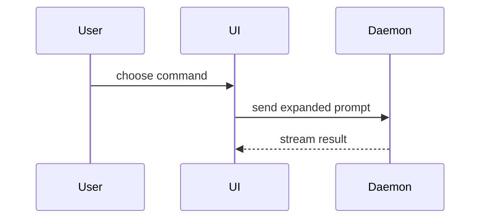
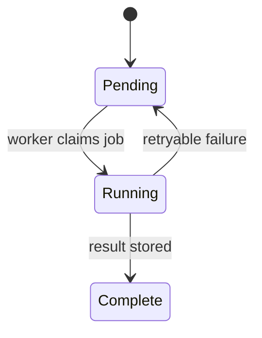

# Mermaid diagram choices

Read this reference when a structured relationship, mapping, topology, or progression may carry the
explanation. Start from the review question. The mappings below are examples and tie-breakers, not an
exhaustive list or a restriction on other renderer-supported Mermaid forms.

| Example question | Strong starting point |
|---|---|
| Which participant sends which message, and in what order? | `sequenceDiagram` |
| Which role or subsystem owns each phase of a process? | `swimlane-beta` |
| How does one entity move among states after events? | `stateDiagram-v2` |
| Which condition, route, dependency, or ownership edge leads where? | `flowchart` |
| Which high-level blocks belong together or connect spatially? | `block` |
| What fields or keys does a database entity have, or how do entities relate? | `erDiagram` |
| Which application types, members, methods, interfaces, or implementations relate? | `classDiagram-v2` |
| Which people or external systems interact with the system under review? | `C4Context` |
| Which deployable or runtime units make up one system? | `C4Container` |
| Which internal components make up one container? | `C4Component` |
| Which C4 elements interact in one runtime scenario? | `C4Dynamic` |
| Which instances and nodes host the system at deployment time? | `C4Deployment` |
| Which infrastructure resources connect without needing C4's hierarchy? | `architecture-beta` |
| Which scheduled tasks have dates, durations, dependencies, or milestones? | `gantt` |
| In what order did milestones or incident events occur? | `timeline` |
| How did commits and branches diverge or merge? | `gitGraph` |
| Which requirement maps to which component or test? | `requirementDiagram` |
| Which bits or fields occupy a wire format? | `packet` |
| Which steps, actors, and satisfaction changes make up a user experience? | `journey` |
| Which ideas branch associatively from one concept? | `mindmap` |
| What is the strict parent-child hierarchy? | `treeView-beta` |
| How does magnitude or composition vary within a hierarchy? | `treemap` |
| How much flow moves between stages? | `sankey` |
| Which work items occupy which delivery states? | `kanban` |
| Where do options land against two tradeoff axes? | `quadrantChart` |
| How do options compare across several common axes? | `radar-beta` |
| How do a few parts contribute to a whole in a compact static sketch? | `pie` |
| How does one small numeric series change across an ordered axis? | `xychart` |
| How do user need, value-chain position, and evolution relate? | `wardley-beta` |
| Which complexity domain does each situation occupy? | `cynefin-beta` |
| How do commands, events, policies, and read models align over time? | `eventmodeling` |
| Which contributing causes lead to one outcome? | `ishikawa` |
| Which sets overlap, and where? | `venn-beta` |
| What paths does Mermaid's generic railroad DSL permit? | `railroad-beta` |
| What paths does an EBNF grammar permit? | `railroad-ebnf-beta` |
| What paths does an ABNF grammar permit? | `railroad-abnf-beta` |
| What paths does a PEG grammar permit? | `railroad-peg-beta` |

For example, use a sequence diagram when order across actors is the point:

Use a state diagram instead when the lifecycle of one entity is the point:

When nearby forms compete, distinguish the mental task:

- A sequence diagram emphasizes event order across participants; a state diagram emphasizes one
  entity's lifecycle.
- A sequence diagram emphasizes messages; a swimlane emphasizes responsibility across process
  phases.
- A flowchart earns its space when branch, join, loop, or cross-boundary topology is itself under
  review. For one local guard or flat result switch, first compare concise prose, pseudocode, or an
  outcome table; the mere presence of branches does not make a flowchart clearer.
- A shallow text or TSX tree shows one small code hierarchy; a Mermaid hierarchy handles a larger
  conceptual hierarchy.
- A flowchart emphasizes routing and cross-links; a block diagram emphasizes spatial grouping; C4
  and architecture diagrams emphasize system or deployment boundaries.
- `FileTree` shows actual paths; Mermaid shows conceptual relationships.
- Mermaid `pie` and `xychart` can carry a tiny static chart. Compare them with `Chart`: Vega-Lite is
  usually stronger when measured evidence needs richer encodings, exact scales, uncertainty,
  composition, or validation.
- Wardley and Cynefin diagrams are useful only when the evidence supports their specialized axes or
  domains; do not use them as generic architecture or categorization diagrams.
- A numbered list or shallow tree is usually clearer than a diagram for one linear path.

Show only review-relevant paths. `difftool walkthrough set` does not validate Mermaid syntax or
layout, so render a diagram before calling it visually verified.
